# Ecosistema tinkuy-qhali

Un *research compendium* agéntico que funciona como GitHub template: bytes crudos fuera de git y resueltos por hash, semántica en un `cdm` versionado, marts publicados según el nivel de congelamiento de su fuente, y una capa agéntica que codifica políticas para que Claude Code opere con poco contexto y sin residuos. No es un dataset ni un paquete R: el producto es la infraestructura de confianza (`docs/research/00-informe-investigacion.md`, pregunta 5).

## Diagrama

Fuente: ADR 0002, 0009, 0010, 0011, 0013, 0014; validado con el MCP de Mermaid el 2026-10-16 (segunda versión tras la revisión adversarial m8) (estilo `docs/style/mermaid-iso5807.md`).

```mermaid
flowchart LR
    ini@{ shape: stadium, label: "Inicio: fuente identificada" }
    inei@{ shape: lin-cyl, label: "Fuentes (INEI, MEF, SUSALUD, clima…)" }
    receta@{ shape: subproc, label: "Receta de descarga + sha256" }
    raw@{ shape: lin-cyl, label: "raw/ en R2 privado (DVC)" }
    reg@{ shape: cyl, label: "tinkuy-qhali-registry: punteros por hash" }
    mirrors@{ shape: doc, label: "MIRRORS.md + verificación" }
    std@{ shape: lean-r, label: "standardized/ Parquet por módulo" }
    harm@{ shape: lean-r, label: "harmonized/ CDM: observation + diseño muestral" }
    marts@{ shape: lean-r, label: "marts/ dismodlite, spatial, impact, prediction" }
    cdm@{ shape: cyl, label: "tinkuy-qhali-cdm: concept, variable_registry, variable_usage, Table Schema" }
    val@{ shape: diam, label: "¿Validadores pasan?" }
    nivel@{ shape: diam, label: "Nivel de congelamiento" }
    zen@{ shape: lin-cyl, label: "Zenodo (DOI) niveles 1–2" }
    salidas@{ shape: doc, label: "Salidas transformadas con cita (nivel 3)" }
    tpl@{ shape: subproc, label: "tinkuy-qhali (plantilla): políticas, skills, hooks" }
    estudio@{ shape: rect, label: "Repo de estudio (consumidor): cdm.lock + data.lock" }
    pr@{ shape: doc, label: "PR al cdm: variable_usage, variables candidatas, calidad" }
    usuario@{ shape: sl-rect, label: "Aprobación humana (ADR, release, licencias)" }
    nada@{ shape: stadium, label: "Fin: nivel 4, nada se publica" }
    fin@{ shape: stadium, label: "Fin: cdm actualizado" }
    ini --> inei --> receta --> raw
    receta --> reg
    reg --> mirrors
    raw --> std --> harm --> marts
    cdm -. contratos .-> std
    cdm -. concept_id .-> harm
    cdm -. Table Schema .-> marts
    marts --> val
    val -- no, corregir etapa --> std
    val -- sí --> nivel
    nivel -- 1 o 2 --> zen
    nivel -- 3 --> salidas
    nivel -- 4 --> nada
    tpl -. crea .-> estudio
    tpl -. crea .-> cdm
    zen --> estudio
    salidas --> estudio
    estudio --> pr --> usuario --> cdm --> fin
    classDef term fill:#e8f5e9,stroke:#2e7d32,stroke-width:1.5px
    classDef proc fill:#e3f2fd,stroke:#1565c0,stroke-width:1px
    classDef dec fill:#fff8e1,stroke:#f9a825,stroke-width:1px
    classDef data fill:#f3e5f5,stroke:#6a1b9a,stroke-width:1px
    classDef human fill:#ffebee,stroke:#c62828,stroke-width:1.5px
    classDef doc fill:#fafafa,stroke:#616161,stroke-width:1px
    classDef store fill:#e0f7fa,stroke:#00838f,stroke-width:1px
    classDef prep fill:#fff3e0,stroke:#ef6c00,stroke-width:1px
    class ini,nada,fin term
    class receta,tpl,estudio proc
    class val,nivel dec
    class std,harm,marts data
    class usuario human
    class mirrors,salidas,pr doc
    class inei,raw,reg,cdm,zen store
```

## Componentes

| Componente | Repo | Qué contiene | Contrato que expone | ADR |
|---|---|---|---|---|
| Plantilla | `tinkuy-qhali` (GitHub template) | imagen, `_targets.R`, políticas, skills, hooks, manuales, `tools/` | `template.lock`; modos `source` y `consumer` | 0002, 0006, 0011, 0013 |
| Capa semántica | `tinkuy-qhali-cdm` | `concept`, `concept_relationship`, `vocabulary`; `variable_registry`; `variable_usage`; diccionarios YAML; Table Schema por capa; validadores | versión semver + `cdm.lock` en los consumidores | 0003, 0009, 0013 |
| Registro de datos | `tinkuy-qhali-registry` | un puntero JSON por archivo crudo (sha256, origen, términos, nivel, `locations[]`), `MIRRORS.md`, verificador | resolución por hash; `pointer.schema.json` | 0007, 0010 |
| Repo de fuente | uno por fuente que cumpla un criterio del ADR 0013 (ENDES ya cumple el de licencia: vive como capítulo de la plantilla solo en Ronda 1 y pasa a `tinkuy-qhali-endes` al abrir la Ronda 2, ADR 0002) | `raw/` (punteros), `standardized/`, `harmonized/`, `marts/`, manifiesto por corrida | marts versionados, `datapackage.json` con sha256, cargadores `tq_load()`/`tq.load()`, `CITATION.cff`, `ERRATA.md` | 0010, 0011, 0013 |
| Repo de estudio | capítulo, o repo propio si cumple un criterio | protocolo, DAG `.dagitty`, análisis | `cdm.lock` + `data.lock`; devuelve `variable_usage`, variables candidatas, hallazgos de calidad por PR | 0009, 0013 |
| Preservación | R2 (operativo), Zenodo (niveles 1–2), disco frío (tercera copia) | bytes por nivel; DOI de concepto y de versión | `MIRRORS.md`, verificación mensual, carta de espejo | 0007, 0010 |

## Capas de datos

| Capa | Dónde viven los bytes | Formato | Entra a git | Quién la produce |
|---|---|---|---|---|
| `raw/` | R2 privado (DVC) + copia fría | original (zip, sav, nc…) | solo `*.dvc`, `manifest.json`, `manifest.sha256` | receta de descarga (`tools/`) |
| `standardized/` | regenerable (volumen) | Parquet por módulo, nombres y tipos originales, etiquetas, claves explícitas | no | `targets` |
| `harmonized/` | regenerable (volumen) | Parquet: `location`, `period`, `household`, `person`, `facility`, `budget_line`, `event`, `climate_cell`, `observation` (con `source_concept_id` y `concept_id`); `weight`, `stratum`, `psu` como columnas | no | `targets` + `cdm` |
| `marts/` | regenerable; publicado según nivel | Parquet + `datapackage.json`; `dismodlite/`, `spatial/`, `impact/`, `prediction/` | no (release) | `targets`; validado por `pointblank`/`pandera` |

## Decisiones que gobiernan el diagrama

1. **Nada se publica sin nivel de congelamiento** (ADR 0010). ENDES está en nivel 3: receta + hash públicos, bytes en R2, solo salidas transformadas con cita.
2. **Todo consumo se fija por versión y hash** (ADR 0013): `cdm.lock`, `data.lock`, `template.lock`; los cargadores abortan si el hash no coincide.
3. **El agente nunca lee datos crudos** (política `context.md`, R16): lee manifiestos, diccionarios estructurados y salidas de validadores.
4. **Toda decisión irreversible pasa por ADR y por el usuario** (nodo `Aprobación humana`): abrir un repo, cambiar de motor o lenguaje, publicar, instalar skills.

## Glosario mínimo

- **R2:** almacenamiento de objetos de Cloudflare compatible con S3; aquí, el remote privado de DVC. **DVC:** herramienta que versiona archivos grandes por hash fuera de git. **DOI:** identificador persistente que emite Zenodo por versión y por concepto. **CDM:** modelo común de datos, el esquema de `harmonized/`. **PSU:** unidad primaria de muestreo (conglomerado) del diseño de la encuesta. **Mart:** tabla derivada lista para un uso (p. ej. insumo de `dismodlite`, el paquete R de carga de enfermedad de Horacio Chacón). **Semver:** versionado `MAJOR.MINOR.PATCH`. **Table Schema:** especificación Frictionless del esquema de una tabla. **`spatial`/`impact`/`prediction`:** marts para modelamiento espacial, evaluación de impacto y predicción.

## Lo que falta para que el diagrama sea código (Fase 3)

`_targets.R`, `tools/bootstrap.py` (modos `source`/`consumer`), los tres `lock`, `tq_load()`/`tq.load()`, `tools/verify_mirrors.py` en el registry, hooks y skills de `docs/policies/*.md`, `run.sh`/`run.bat`. La lista completa con ronda está en `docs/research/26-lo-que-falta.md` y su anexo.
