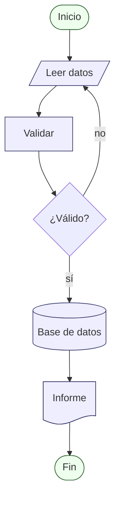

# Anexo 16 — Mapeo ISO 5807 → Mermaid

Fuentes: https://mermaid.js.org/syntax/flowchart.html (consulta 2026-10-16); https://en.wikipedia.org/wiki/Flowchart [no oficial] (2026-10-16). Sintaxis clásica de corchetes **[provisional]**.

| Símbolo ISO 5807 | Forma `@{ shape }` (versión mínima) | Forma clásica | Estado |
|---|---|---|---|
| Proceso | `rect` (11.3.0) | `[texto]` | exacta |
| Decisión | `diam` (11.3.0) | `{texto}` | exacta |
| Documento | `doc` (11.3.0) | sin forma clásica | exacta |
| Datos entrada/salida | `lean-r` (11.3.0) | `[/texto/]` | exacta |
| Disco (almacenamiento) | `lin-cyl` (11.3.0) | `[(texto)]` | exacta |
| Base de datos (almacenamiento) | `cyl` (11.3.0) | `[(texto)]` | exacta |
| Terminal (inicio/fin) | `stadium` (11.3.0) | `([texto])` | exacta |
| Proceso predefinido | `subproc` (11.3.0) | `[[texto]]` | exacta |
| Preparación | `hex` (11.3.0) | `{{texto}}` | exacta |
| Entrada manual | `sl-rect` (11.3.0) | `[/texto\]` | exacta |
| Conector (en página) | `circle` (11.3.0) | `((texto))` | aproximada (etiqueta + classDef) |
| Conector fuera de página | sin forma; alternativa `notch-pent` | sin forma | **sin forma exacta** |
| Línea de flujo | flecha `-->` | flecha `-->` | no es nodo |

Colores ISO sugeridos con `classDef` (ejemplo, no renderizado en esta sesión; validez de `@{ shape }` según Mermaid >= 11.3.0 **[provisional]**):

