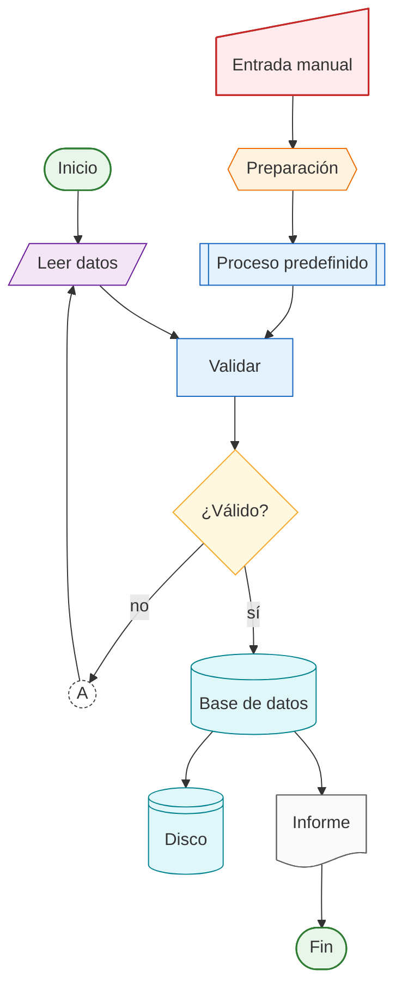

# Estilo de diagramas: Mermaid con símbolos ISO 5807

Todo flujograma del ecosistema (`docs/architecture/`, manuales, skills) usa Mermaid `flowchart` con la sintaxis `@{ shape: ... }` y las clases de este archivo. Un lector debe reconocer el tipo de cada nodo por su forma sin leer la etiqueta.

## Requisitos

- Mermaid **≥ 11.3.0** (la sintaxis `@{ shape }` no existe antes; https://mermaid.js.org/syntax/flowchart.html, consultado 2026-10-16).
- Validación obligatoria antes de commit: el diagrama de referencia de abajo y cada diagrama nuevo se validan con el MCP de Mermaid (`validate_and_render_mermaid_diagram`) o con `mmdc` dentro del contenedor. El diagrama de referencia validó el 2026-10-16 (`valid: true`, `flowchart`, SVG de 102 KB).
- **[provisional]** La versión de Mermaid que incluye Quarto 1.10 y la que usa GitHub no se verificaron; la Fase 2 renderiza `docs/architecture/01-ecosistema.md` en el sitio y en GitHub y anota el resultado aquí.

## Mapeo símbolo ISO 5807 → forma Mermaid

| Símbolo ISO 5807 | Uso en tinkuy-qhali | `@{ shape }` | Clase |
|---|---|---|---|
| Terminal (inicio/fin) | inicio y fin de un flujo, sesión o fase | `stadium` | `term` |
| Proceso | paso ejecutado por código o por el agente | `rect` | `proc` |
| Proceso predefinido | skill, target de `targets`, script reutilizable | `subproc` | `proc` |
| Decisión | bifurcación (validador pasa/falla, nivel de congelamiento) | `diam` | `dec` |
| Datos (entrada/salida) | Parquet, CSV, JSON que entra o sale de un paso | `lean-r` | `data` |
| Entrada manual | decisión o aprobación del usuario | `sl-rect` | `human` |
| Documento | ADR, informe, bitácora, manifiesto | `doc` | `doc` |
| Base de datos | DuckDB, tablas del `cdm`, registry | `cyl` | `store` |
| Disco / almacenamiento | R2, caché DVC, volumen Docker, Zenodo | `lin-cyl` | `store` |
| Preparación | configuración previa (perfil de máquina, `.env`, cuarentena) | `hex` | `prep` |
| Conector en página | salto dentro del mismo diagrama | `circle` con letra | `conn` |
| Conector fuera de página | salto a otro diagrama (ISO lo dibuja como pentágono) | **sin forma exacta**: `circle` con etiqueta `→ 0N` y clase `conn-ext` | `conn-ext` |
| Flujo | dependencia o secuencia | `-->` ; flujo de datos `-.->` ; flujo bloqueado `--x` | — |

Reglas de uso:

1. Un diagrama tiene exactamente un nodo `term` de inicio y al menos uno de fin.
2. Las decisiones salen siempre con dos o más flechas etiquetadas (`-- sí -->`, `-- no -->`, `-- nivel 3 -->`).
3. La aprobación humana nunca se dibuja como proceso: siempre `sl-rect` con clase `human`, para que se vea dónde interviene el usuario.
4. Los almacenes distinguen base de datos (`cyl`: consulta) de disco (`lin-cyl`: bytes inmutables).
5. Un diagrama no supera 25 nodos; si crece, se parte y se enlaza con `conn-ext` y el nombre del otro archivo.
6. Etiquetas en español, cortas, sin código salvo nombres de archivo entre comillas.
7. Cada diagrama lleva, en el Markdown que lo contiene, una línea `Fuente:` con el ADR o informe que lo respalda y la fecha de validación.

## Bloque de clases (copiar al final de cada diagrama)

```
    classDef term fill:#e8f5e9,stroke:#2e7d32,stroke-width:1.5px
    classDef proc fill:#e3f2fd,stroke:#1565c0,stroke-width:1px
    classDef dec fill:#fff8e1,stroke:#f9a825,stroke-width:1px
    classDef data fill:#f3e5f5,stroke:#6a1b9a,stroke-width:1px
    classDef human fill:#ffebee,stroke:#c62828,stroke-width:1.5px
    classDef doc fill:#fafafa,stroke:#616161,stroke-width:1px
    classDef store fill:#e0f7fa,stroke:#00838f,stroke-width:1px
    classDef prep fill:#fff3e0,stroke:#ef6c00,stroke-width:1px
    classDef conn fill:#ffffff,stroke:#424242,stroke-dasharray: 3 2
    classDef conn-ext fill:#ffffff,stroke:#424242,stroke-width:2px,stroke-dasharray: 6 3
```

## Diagrama de referencia (validado 2026-10-16)

Fuente: `docs/research/_16-anexo-mapeo.md`; validación con el MCP de Mermaid el 2026-10-16.



## Alternativas descartadas

- PlantUML y Graphviz: sin render nativo en GitHub ni en Quarto sin dependencias externas (informe 16).
- Sintaxis clásica de corchetes (`[]`, `{}`, `([])`): no cubre documento ni entrada manual; se admite solo en diagramas heredados hasta migrarlos.

## Cómo se verifica

- `tools/check_mermaid.py` (Fase 3, [propuesta]): extrae cada bloque ```` ```mermaid ```` de `docs/**/*.md`, exige el bloque de clases y la línea `Fuente:`, y lo valida con `mmdc` en el contenedor.
- Hasta entonces: validación manual con el MCP y anotación de la fecha en la línea `Fuente:`.
